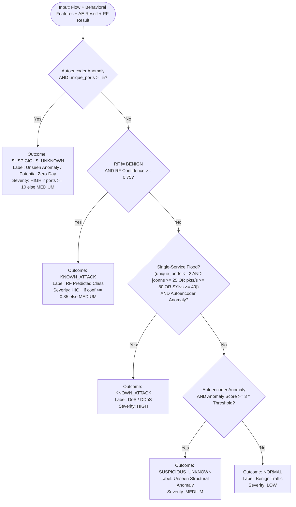

# ZeroDay IDS — Machine Learning Pipeline Deep Dive

This document provides a comprehensive analysis of the machine learning detection and explainability components within ZeroDay IDS, including feature representations, model architectures, preprocessing pipelines, decision logic, and known feature distribution nuances between training and live capture.

---

## 1. Input Features & Preprocessing Pipeline

Both the Deep Autoencoder and Random Forest models evaluate network flows using a compact, 9-dimensional statistical feature representation derived from benchmark intrusion datasets (such as CSE-CIC-IDS2018 / CNS2022).

### 1.1 The Nine Input Features
| Index | Feature Name (Model B) | Data Type | Units / Range | Description & Derivation |
| :---: | :--- | :---: | :---: | :--- |
| **0** | `Dst Port` | Float64 | $0 - 65535$ | Target destination port of the service being accessed. |
| **1** | `Flow Duration` | Float64 | Microseconds ($\mu s$) | Total flow duration. Calculated as $\Delta t \times 1,000,000$ (where $\Delta t = last\_seen - start\_time$ in seconds). |
| **2** | `Total Fwd Packet` | Float64 | Integer count $\ge 0$ | Cumulative packets sent from flow initiator (client) to responder. |
| **3** | `Total Bwd packets` | Float64 | Integer count $\ge 0$ | Cumulative packets sent from responder (server) back to initiator. |
| **4** | `Total Length of Fwd Packet` | Float64 | Bytes $\ge 0$ | Cumulative payload and header bytes sent in the forward direction. |
| **5** | `Total Length of Bwd Packet` | Float64 | Bytes $\ge 0$ | Cumulative payload and header bytes sent in the backward direction. |
| **6** | `Flow Bytes/s` | Float64 | $\ln(1 + \text{bytes/sec})$ | Total bytes ($fwd + bwd$) divided by duration in seconds, transformed via $\ln(1 + x)$. |
| **7** | `Flow Packets/s` | Float64 | $\ln(1 + \text{pkts/sec})$ | Total packets ($fwd + bwd$) divided by duration in seconds, transformed via $\ln(1 + x)$. |
| **8** | `SYN Flag Count` | Float64 | Integer count $\ge 0$ | Total number of TCP packets observed with the SYN flag set. |

### 1.2 Preprocessing & Feature Transformations
1. **Duration Unit Conversion**:
   In live packet capture, timestamps are recorded in seconds (using Python's `time.time()`). Training datasets (e.g., CIC-IDS) record duration in microseconds ($\mu s$). To prevent severe feature scale mismatch, both `autoencoder_detector.py` and `rf_detector.py` convert duration:
   ```python
   duration = max(float(flow["duration"]), 0.000001) # Guard against division by zero
   duration_us = duration * 1_000_000
   ```
2. **Log-Transform of Heavy-Tailed Rate Features**:
   Network traffic rates exhibit extreme skewness (from low-bandwidth interactive sessions to gigabit bulk transfers). During model training, `Flow Bytes/s` and `Flow Packets/s` were normalized using natural log plus one:
   ```python
   raw_features[0, 6] = np.log1p(max(raw_features[0, 6], 0.0))
   raw_features[0, 7] = np.log1p(max(raw_features[0, 7], 0.0))
   ```
3. **Standardization (`StandardScaler`)**:
   - **Autoencoder**: Scaled using `models/model B/scaler.joblib`. The scaler shifts and scales all 9 features to zero mean and unit variance based on benign training baselines.
   - **Random Forest**: Tree-based models are scale-invariant; the Random Forest operates directly on the unscaled feature matrix (with $\ln(1+x)$ applied to rate features).

---

## 2. Component 2: Benign-Only Deep Autoencoder (`autoencoder_detector.py`)

### 2.1 Theoretical Foundation
The Autoencoder operates on an unsupervised novelty detection paradigm. It is trained **exclusively on benign (normal) network flows**. By optimizing the network to reconstruct benign patterns, the model minimizes reconstruction error for normal traffic. When an attack or zero-day anomaly is introduced, the unfamiliar statistical relationships result in a significantly higher reconstruction error, exceeding the calibrated threshold.

### 2.2 Neural Network Architecture
The model is implemented in PyTorch as a 7-layer fully connected symmetric autoencoder:

```
[Input: 9 features]
        |
    Linear(9 -> 64)  +  ReLU()
        |
    Linear(64 -> 32) +  ReLU()
        |
    Linear(32 -> 16)               <-- Latent Bottleneck (16 Dimensions)
        |
    Linear(16 -> 32) +  ReLU()
        |
    Linear(32 -> 64) +  ReLU()
        |
    Linear(64 -> 9)
        |
[Reconstructed Output: 9 features]
```

### 2.3 Layer Specifications & Parameter Count
| Layer | Input Dimension | Output Dimension | Activation | Weight Parameters | Bias Parameters |
| :--- | :---: | :---: | :---: | :---: | :---: |
| `encoder.0` | 9 | 64 | ReLU | $9 \times 64 = 576$ | 64 |
| `encoder.2` | 64 | 32 | ReLU | $64 \times 32 = 2,048$ | 32 |
| `encoder.4` | 32 | 16 | None | $32 \times 16 = 512$ | 16 |
| `decoder.0` | 16 | 32 | ReLU | $16 \times 32 = 512$ | 32 |
| `decoder.2` | 32 | 64 | ReLU | $32 \times 64 = 2,048$ | 64 |
| `decoder.4` | 64 | 9 | None | $64 \times 9 = 576$ | 9 |
| **Total Model Parameters** | | | | **6,272 weights + 227 biases = 6,499 parameters** |

### 2.4 Anomaly Scoring & Threshold Calibration
Given input vector $\vec{x}$ and reconstructed output $\hat{\vec{x}}$, the per-feature squared error is computed:
$$e_i = (\hat{x}_i - x_i)^2, \quad i \in \{1, \dots, 9\}$$
The overall flow anomaly score is the Mean Squared Error (MSE):
$$\text{MSE} = \frac{1}{9}\sum_{i=1}^{9} e_i$$

- **Calibrated Threshold**: `0.004877559` (stored in `models/model B/threshold.npy` and `metadata.json`).
- **Decision Rule**:
  $$\text{is\_anomaly} = \begin{cases} \text{True}, & \text{MSE} > 0.004877559 \\ \text{False}, & \text{MSE} \le 0.004877559 \end{cases}$$
- **Per-Feature Error Attribution**: `feature_contributions` maps each feature to its specific error contribution $e_i$, sorted in descending order to identify which attributes drove the anomaly.

---

## 3. Component 3: Random Forest Classifier (`rf_detector.py`)

### 3.1 Model Architecture & Configuration
The Random Forest model (`models/model B/random_forest.joblib`) is a supervised ensemble classifier trained to recognize known attack signatures:
- **Algorithm**: `sklearn.ensemble.RandomForestClassifier`
- **Number of Estimators**: 100 decision trees (`n_estimators=100`)
- **Maximum Tree Depth**: 16 (`max_depth=16`)
- **Target Classes (6 families)**:
  1. `BENIGN`
  2. `Botnet`
  3. `Brute Force`
  4. `DoS / DDoS`
  5. `Infiltration`
  6. `Web Attack`

### 3.2 Feature Importances
Inspecting the serialized Random Forest model reveals the relative importance assigned to each feature during training:

| Feature Name | Feature Importance Score | Interpretation |
| :--- | :---: | :--- |
| `Total Length of Bwd Packet` | **0.3679** (36.8%) | Primary discriminator: Server response volume distinguishes web attacks, data exfiltration, and DoS. |
| `Total Fwd Packet` | **0.2119** (21.2%) | Key indicator for connection floods, port probes, and brute-force attempts. |
| `Dst Port` | **0.1393** (13.9%) | Service destination separates web attacks (80/443/8001), SSH (22), and botnet C2 channels. |
| `Total Bwd packets` | **0.1181** (11.8%) | Tracks whether the server accepted and responded to requests. |
| `SYN Flag Count` | **0.0833** (8.3%) | Primary signature for SYN flood DoS attacks and port scans. |
| `Total Length of Fwd Packet` | **0.0267** (2.7%) | Payload volume generated by the attacker. |
| `Flow Bytes/s` | **0.0209** (2.1%) | Bandwidth consumption rate. |
| `Flow Duration` | **0.0189** (1.9%) | Temporal longevity of the connection. |
| `Flow Packets/s` | **0.0130** (1.3%) | Packet density rate. |

---

## 4. Component 4: Unified Decision Engine (`decision_engine.py`)

The Decision Engine combines the unsupervised Autoencoder score, the supervised Random Forest prediction, and host-level behavioral telemetry to produce a final verdict.



### 4.1 Evaluation Logic Breakdown
1. **Branch 1: Zero-Day Multi-Port Reconnaissance (`SUSPICIOUS_UNKNOWN`)**:
   - Condition: `ae_anomalous is True` AND `unique_ports >= 5`
   - Rationale: High-entropy port probing spread across multiple ports violates benign single-session baselines. Even if Random Forest suggests a known class or Benign, multi-port structural deviations indicate a zero-day port scan or reconnaissance probe.
2. **Branch 2: Confirmed Known Attack Signature (`KNOWN_ATTACK`)**:
   - Condition: `rf_class != "BENIGN"` AND `rf_confidence >= 0.75`
   - Rationale: High-confidence signature match against one of the five attack categories.
3. **Branch 3: Single-Service High-Volume Flood (`KNOWN_ATTACK`)**:
   - Condition: `unique_ports <= 2` AND (`conn_count >= 25` OR `packet_rate >= 80.0` OR `syn_count >= 40`) AND `ae_anomalous is True`
   - Rationale: Captures high-rate DoS / DDoS floods targeted at a single application port (e.g., port 8001).
4. **Branch 4: Severe Single-Flow Structural Anomaly (`SUSPICIOUS_UNKNOWN`)**:
   - Condition: `ae_anomalous is True` AND `ae_score >= (ae_thresh * 3.0)` ($> 0.01463$)
   - Rationale: Reconstruction error exceeds $3\times$ the baseline threshold, indicating an exploit with atypical header/payload ratios (such as buffer overflows or malformed packets).
5. **Branch 5: Normal Baseline Traffic (`NORMAL`)**:
   - Default fall-through for flows within normal behavioral and statistical limits.

### 4.2 Temporal Deduplication
To prevent alert fatigue when an attack generates dozens of flows per second, `DecisionEngine` implements a 4-second deduplication filter:
```python
def _is_duplicate(self, source_ip, outcome, attack_label):
    now = time.time()
    key = (source_ip, outcome, attack_label)
    last_time = self.recent_alerts.get(key)
    if last_time and (now - last_time) < self.dedup_window_seconds:
        return True
    self.recent_alerts[key] = now
    return False
```
Duplicate alerts are still recorded in `recent_flows` and increment counter stats, but are omitted from `self.alerts` (the dedicated Security Alert Feed).

---

## 5. Component 5: Explainability Engine (`xai_engine.py`)

### 5.1 Dual Explainability Paradigms
Security analysts require clear explanations for AI decisions. `ExplainabilityEngine` dynamically adapts its explanatory method based on the verdict outcome:

```
                          Decision Outcome
                                 |
        +------------------------+------------------------+
        |                                                 |
  KNOWN_ATTACK                                   SUSPICIOUS_UNKNOWN
        |                                                 |
  RF Signature Match?                             Autoencoder Error +
  - Yes: SHAP TreeExplainer                       Host Behavioral Telemetry
  - No (DoS Flood): Behavioral Metrics            (Top reconstructed deviations +
    + Autoencoder Metrics                          probing indicators)
```

### 5.2 SHAP TreeExplainer for Random Forest
For known attacks classified by Random Forest, exact Shapley values are calculated:
```python
self.rf_explainer = shap.TreeExplainer(rf_model)
shap_values = self.rf_explainer.shap_values(feature_df)
```
- Extracts the Shapley contribution of all 9 features for the predicted class.
- Ranks features by absolute magnitude: $|v_i|$.
- Surfaces the top 4 contributing features with signed contributions (e.g., `Total Length of Bwd Packet (+0.412)`).

### 5.3 Autoencoder Reconstruction Attribution for Zero-Day Events
For `SUSPICIOUS_UNKNOWN` flows, SHAP is not applicable because the event represents an unlabelled anomaly. Instead, the engine extracts the top 3 features with the highest squared reconstruction error from the Autoencoder, coupled with behavioral context:
```python
# Example generated summary:
"Unseen anomaly detected (not matched to any known attack signature). Top Autoencoder deviations: Total Fwd Packet (err=0.0124), SYN Flag Count (err=0.0089). Behaviorally, the source host probed 14 unique destination ports in 10s and opened 22 rapid connections."
```

---

## 6. Model A vs. Model B Comparison

The repository houses artifacts for two model iterations in `models/model A` and `models/model B`:

| Property | Model A (`models/model A`) | Model B (`models/model B` — Active) |
| :--- | :--- | :--- |
| **Model Type** | Autoencoder only | **Dual: Autoencoder + Random Forest** |
| **Input Feature Names** | `Destination Port`, `Flow Duration`, `Total Fwd Packets`, `Total Backward Packets`, `Total Length of Fwd Packets`, `Total Length of Bwd Packets`, `Flow Bytes/s`, `Flow Packets/s`, `SYN Flag Count` | `Dst Port`, `Flow Duration`, `Total Fwd Packet`, `Total Bwd packets`, `Total Length of Fwd Packet`, `Total Length of Bwd Packet`, `Flow Bytes/s`, `Flow Packets/s`, `SYN Flag Count` |
| **AE Threshold** | `0.0170905` (99.5th percentile) | `0.004877559` |
| **Best Val Loss** | Not stated in metadata | `0.000456635` |
| **Random Forest** | None (no `.joblib` present) | Included (`random_forest.joblib`, 4.65 MB) |
| **Active Pipeline Status** | Inactive legacy iteration | **Active production model loaded by `ids_pipeline.py`** |

> [!WARNING]
> Model A and Model B use different feature column naming conventions (`Destination Port` vs `Dst Port`). Model A's `scaler.joblib` cannot be used with Model B code, as `StandardScaler` validates input feature names against `feature_names_in_`.

---

## 7. Known Training vs. Live Feature Realities

1. **Duration Granularity**:
   Training datasets calculate duration from high-precision PCAP timestamps ($\mu s$). Live capture relies on Python `time.time()` float timestamps, which on Windows has an effective clock resolution of approximately 1 to 15 milliseconds. For micro-flows ($< 1$ ms), duration is clamped to `0.000001s` to prevent division by zero.
2. **Idle Flow Slicing**:
   In benchmark datasets, flows are bounded by TCP FIN/RST flags or maximum session cutoffs. In ZeroDay IDS, flows are sliced based purely on an idle timeout ($5$s inactivity). Consequently, persistent TCP connections remain open across multiple HTTP requests until the user stops browsing.
3. **SYN-ACK Server First Normalization**:
   If packet sniffing begins mid-session (after the initial SYN handshake has passed), the heuristic assigns the lower port number as the server. While accurate for standard ports ($80, 443, 8001$), connections between two non-standard or high-numbered ports may result in inverted forward/backward counts.

