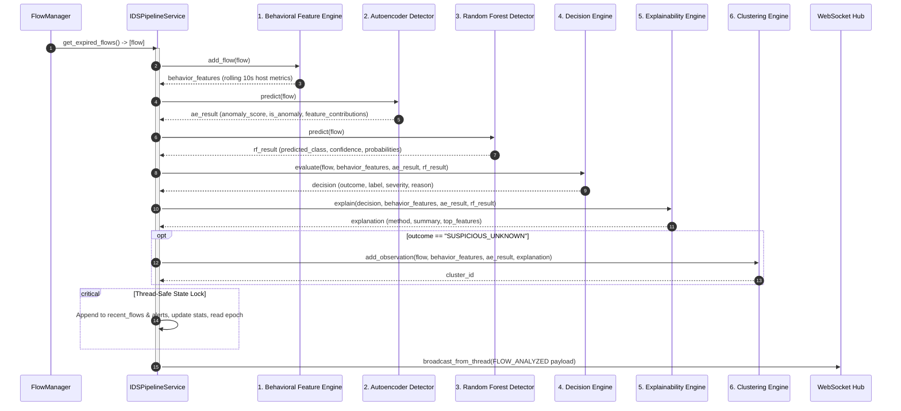

# ZeroDay IDS — End-to-End System Architecture

This document reconstructs the complete, implemented architecture of ZeroDay IDS, tracing the lifecycle of data from raw network frames captured on a virtual adapter through the six-component machine learning detection pipeline to the live React threat monitor.

---

## 1. End-to-End Architectural Dataflow

```mermaid
flowchart TD
    subgraph External_Network ["External Attacker / Client (Kali Linux VM: 192.168.137.128)"]
        Attacker["Attack Scripts / Nmap / Hydra / Hping3 / Normal Browsing"]
    end

    subgraph Host_Network ["Windows Host Network Stack (192.168.137.1)"]
        VMnet1["VMware Virtual Ethernet Adapter (VMnet1, Index 12)"]
        TargetApp["NexaVault Website (port 8001, python -m http.server)"]
    end

    Attacker -->|TCP / IP Packets| VMnet1
    VMnet1 -->|Local Delivery| TargetApp

    subgraph Capture_Layer ["Capture & Ingestion Layer (Scapy Thread)"]
        Sniffer["Scapy sniff() Loop (filter='ip', timeout=1)"]
        Parser["_parse_packet() -> Drops broadcast/multicast, extracts 5-tuple"]
        FlowMgr["FlowManager: add_packet()"]
        FlowCache[("Active Bidirectional Flows Cache: dict[5-tuple, flow]")]
        Expiration["FlowManager.get_expired_flows(idle_timeout >= 5s)"]
    end

    VMnet1 -.->|Promiscuous Sniffing| Sniffer
    Sniffer --> Parser
    Parser --> FlowMgr
    FlowMgr <--> FlowCache
    Sniffer --> Expiration
    FlowCache --> Expiration

    subgraph ML_Pipeline ["Six-Component ML Pipeline (Python Thread)"]
        direction TB
        ExpiredFlows["Completed Expired Flows"]
        
        subgraph Parallel_Extraction ["Feature & Anomaly Processing"]
            C1["1. BehavioralFeatureEngine (10s rolling host window)"]
            C2["2. AutoencoderDetector (PyTorch 9-dim MSE vs 0.00488)"]
            C3["3. RandomForestDetector (100 trees, 6-class signature)"]
        end

        C4["4. DecisionEngine (Heuristic & Threshold Synthesis)"]
        C5["5. ExplainabilityEngine (SHAP TreeExplainer / AE Error Ranking)"]
        C6["6. ClusteringEngine (DBSCAN eps=1.2, min_samples=3)"]

        ExpiredFlows --> C1
        ExpiredFlows --> C2
        ExpiredFlows --> C3
        C1 & C2 & C3 --> C4
        C4 --> C5
        C4 -->|If SUSPICIOUS_UNKNOWN| C6
    end

    Expiration --> ExpiredFlows

    subgraph State_Sync ["Thread-Safe State Synchronization"]
        Lock["threading.Lock()"]
        Epoch["Reset Epoch Counter (_reset_epoch)"]
        StatsBuffer[("Dashboard Stats & Uptime")]
        FlowsBuffer[("recent_flows: deque(maxlen=100)")]
        AlertsBuffer[("alerts: deque(maxlen=100)")]
    end

    C4 & C5 & C6 --> Lock
    Lock --> StatsBuffer & FlowsBuffer & AlertsBuffer & Epoch

    subgraph API_Layer ["API & WebSocket Hub (FastAPI, Port 8000)"]
        AsyncLoop["Main asyncio Event Loop"]
        ThreadSafe["asyncio.run_coroutine_threadsafe()"]
        WSHub["WebSocket Clients Pool (connected_clients)"]
        REST["REST API (/api/stats, /api/flows, /api/alerts, /api/reset)"]
    end

    Lock -.->|on_event_callback| ThreadSafe
    ThreadSafe --> AsyncLoop
    AsyncLoop --> WSHub

    subgraph Frontend_UI ["Live Threat Monitor Frontend (React 19 + Vite, Port 5173)"]
        WSClient["WebSocket Client: ws://localhost:8000/ws/live"]
        EpochFilter{"Epoch Guard: msg.epoch >= epochRef.current?"}
        UIState["React State (stats, flows, selectedFlow)"]
        Table["Recent Network Traffic Table (Latest 20)"]
        Modal["XAI Inspection Modal (SHAP / AE Drivers)"]
        ResetBtn["Reset Button -> POST /api/reset"]
    end

    WSHub -->|FLOW_ANALYZED / RESET / INITIAL_STATE| WSClient
    WSClient --> EpochFilter
    EpochFilter -->|Valid| UIState
    EpochFilter -->|Stale (epoch < current)| Drop[Discard Stale Message]
    UIState --> Table
    UIState --> Modal
    ResetBtn -->|POST /api/reset| REST
    REST -->|pipeline.reset()| Lock
```

---

## 2. Step-by-Step Subsystem Architecture

### 2.1 Packet Ingestion & Parsing
1. **Network Interface Binding**: The pipeline binds to interface index 12 via `conf.ifaces.dev_from_index(12)`. On the deployment host, index 12 represents `VMware Virtual Ethernet Adapter for VMnet1` with host IP `192.168.137.1`.
2. **Promiscuous Sniffing**: `scapy.all.sniff()` runs in a continuous loop with `store=False`, `filter="ip"`, and `timeout=1`. This timeout ensures that the thread periodically awakens to process expired flows even during lulls in network activity.
3. **Filtering & Normalization**:
   - Packets lacking an IPv4 layer (`IP not in packet`) are dropped immediately.
   - Multicast (`224.0.0.0/4`, `239.0.0.0/8`) and IPv4 limited broadcast (`255.255.255.255`) packets are rejected in `_parse_packet()` to prevent router control noise from skewing flow features.
   - Ports and protocol are extracted: `TCP` packets yield source port, destination port, and TCP flags string; `UDP` packets yield ports without flags; all other protocols are marked `"Other"`.

### 2.2 Bidirectional Flow Aggregation (`FlowManager`)
1. **Endpoints Key**: Endpoints are sorted to form a canonical direction-agnostic flow key:
   $$\text{endpoints} = \text{tuple}(\text{sorted}([(src\_ip, src\_port), (dst\_ip, dst\_port)]))$$
   $$\text{key} = (\text{endpoints}, \text{protocol})$$
2. **TCP/IP Role Normalization**:
   To ensure consistent forward/backward packet counts regardless of which host sends a packet first:
   - A pure SYN packet (`"S" in flags and "A" not in flags`) defines the initiator as the forward client.
   - A SYN-ACK packet (`"S" in flags and "A" in flags`) defines the sender as the backward server.
   - Mid-stream packets without SYN assign the lower port ($< 32768$) as the listening service (server), and the higher ephemeral port as the client.
3. **Flow State Accumulation**: Each flow record tracks `start_time`, `last_seen`, `packet_count`, `byte_count`, directional packet/byte counts (`fwd_packets`, `bwd_packets`, `fwd_bytes`, `bwd_bytes`), and per-direction TCP flag counters.
4. **Flow Expiration**: When `now - flow["last_seen"] >= idle_timeout` (5 seconds in `ids_pipeline.py`), the flow is deemed terminated, its total duration is computed ($\Delta t = last\_seen - start\_time$), popped from the active flows dictionary, and dispatched to the ML pipeline.

### 2.3 Six-Component Machine Learning Pipeline



1. **Component 1 — Behavioral Feature Engine**:
   Maintains a `defaultdict(deque)` storing recent flows per source IP. Discards flows older than 10 seconds. Calculates:
   - `connection_count`: Number of connections in the 10s window.
   - `unique_destination_ports`: Count of distinct ports targeted by the source IP.
   - `packet_rate`: Total window packets divided by window duration (10s).
   - `syn_count`: Sum of TCP SYN flags emitted across all window flows.
2. **Component 2 — Autoencoder Detector (PyTorch)**:
   Extracts 9 flow features, transforms `Flow Duration` to microseconds ($\mu s$), applies $\ln(1 + x)$ to `Flow Bytes/s` and `Flow Packets/s`, scales via `StandardScaler`, and runs a forward pass through the symmetric autoencoder. It calculates Mean Squared Error:
   $$\text{MSE} = \frac{1}{9}\sum_{i=1}^{9} (\hat{x}_i - x_i)^2$$
   If $\text{MSE} > 0.004877559$, `is_anomaly` is set to `True`.
3. **Component 3 — Random Forest Detector (Scikit-Learn)**:
   Takes the unscaled 9 features (with $\ln(1 + x)$ applied to rate features) and computes multi-class probabilities across `['BENIGN', 'Botnet', 'Brute Force', 'DoS / DDoS', 'Infiltration', 'Web Attack']`.
4. **Component 4 — Decision Engine**:
   Synthesizes the outputs using prioritized conditional logic:
   - **Branch 1: Zero-Day Multi-Port Reconnaissance (`SUSPICIOUS_UNKNOWN`)**: Triggered when `ae_anomalous is True` AND `unique_ports >= 5`. Overrides random forest benign/attack predictions because distributed scanning across multiple ports is an anomaly signature.
   - **Branch 2: Known Attack (`KNOWN_ATTACK`)**: Triggered when `rf_class != 'BENIGN'` AND `rf_conf >= 0.75`. Alternatively triggered when a single-service flood occurs (`unique_ports <= 2` with `conn_count >= 25`, `packet_rate >= 80`, or `syn_count >= 40`) and the autoencoder flags an anomaly.
   - **Branch 3: Severe Structural Anomaly (`SUSPICIOUS_UNKNOWN`)**: Triggered when `ae_anomalous is True` and the anomaly score is $\ge 3 \times$ the baseline threshold ($0.004877 \times 3 = 0.01463$), indicating severe payload or header structural corruption without an RF signature.
   - **Branch 4: Normal Traffic (`NORMAL`)**: All other traffic that conforms to baseline distributions.
5. **Component 5 — Explainability Engine (SHAP & AE Error Attribution)**:
   - For `KNOWN_ATTACK` where RF matched: Uses `shap.TreeExplainer` on the Random Forest model to calculate exact Shapley feature values for the predicted class, returning the top 4 contributing features.
   - For DoS floods: Generates a plain-English behavioral summary detailing connection frequency, packet rate, and targeted ports.
   - For `SUSPICIOUS_UNKNOWN`: Ranks the top Autoencoder reconstruction errors and correlates them with behavioral indicators (e.g., "probed 12 unique destination ports in 10s").
6. **Component 6 — Clustering Engine (DBSCAN)**:
   When an unknown anomaly is flagged, its 10-dimensional behavioral and statistical vector is appended to a 500-sample buffer:
   $$\vec{v} = [dst\_port, duration, fwd\_pkts, bwd\_pkts, fwd\_bytes, bwd\_bytes, unique\_ports, conns, pkt\_rate, ae\_score]$$
   Standardizes $\vec{v}$ with `StandardScaler` and runs `DBSCAN(eps=1.2, min_samples=3)`. Points with dense neighbors are assigned a non-negative `cluster_id` ($\ge 0$), while isolated anomalies receive noise label `-1`. Cluster summaries identify dominant attack characteristics (e.g., "Multi-Port Probing Pattern").

### 2.4 Thread-Safe Synchronization & State Management
Because Scapy runs inside a background worker thread (`capture_thread = threading.Thread(target=pipeline.run_capture_loop, daemon=True)`) while HTTP and WebSocket requests run on FastAPI's asynchronous event loop, concurrent state mutations are guarded:
- **`threading.Lock`**: Protects `self.stats`, `self.recent_flows`, and `self.alerts`.
- **`_reset_epoch` Counter**: Incremented on every `/api/reset` invocation. Stamped on all subsequent `FLOW_ANALYZED` broadcasts.
- **Cross-Thread Event Dispatch**: `broadcast_from_thread()` uses `asyncio.run_coroutine_threadsafe(broadcast_json(payload), main_event_loop)` to safely post WebSocket broadcasts from the synchronous Scapy thread into FastAPI's async event loop.

### 2.5 Frontend Ingestion & React 19 State Updates
1. **WebSocket Lifecycle**: Upon mounting, `App.jsx` opens `ws://localhost:8000/ws/live`.
2. **Snapshot Ingestion**: The backend immediately transmits an `INITIAL_STATE` payload containing current stats, the latest 20 flows, active alerts, and current epoch.
3. **Real-Time Stream Processing**:
   - `FLOW_ANALYZED`: When a message arrives, `epochRef.current` is checked. If `data.epoch < epochRef.current`, the message is discarded as stale. Otherwise, `setStats` updates the KPI cards, and `setFlows((prev) => [newFlow, ...prev.slice(0, 19)])` prepends the new flow while maintaining a 20-row ceiling.
   - `RESET`: When the server completes a reset, it broadcasts `{"type": "RESET", "epoch": new_epoch, ...}`. The client updates `epochRef.current = data.epoch`, clears flows (`setFlows([])`), and zeroes stats.

---

## 3. Discrepancies: Intended Architecture vs. Actual Implementation

During the technical audit, several differences between conceptual architecture and actual source code were identified:

| Conceptual Architecture | Implemented Code Reality | Technical Impact |
| :--- | :--- | :--- |
| **Model Version** | Repo contains both `model A` and `model B`. `backend/services/ids_pipeline.py` specifically instantiates `model_dir="models/model B"`. | Model A artifacts are legacy. Model B is the active production model. Model A's scaler cannot be used with Model B due to feature naming differences (`Destination Port` vs `Dst Port`). |
| **Active Flow Timeout** | Conceptual flow managers often specify an active timeout (e.g. 120s max duration). | `FlowManager` only implements an `idle_timeout` (5s). Long-running persistent connections (like continuous streaming or long SSH sessions) will never expire until they go silent for 5 consecutive seconds. |
| **ML Inference Threading** | Inference is conceptually depicted as a decoupled worker pool or message queue. | `process_expired_flows()` executes ML inference **synchronously inside the Scapy capture loop thread**. If PyTorch or SHAP computation takes 50ms, Scapy packet sniffing is paused for 50ms, potentially dropping high-volume bursts. |
| **Clustering Recomputation** | Clustering is conceptually depicted as an incremental background task. | DBSCAN runs synchronously on the entire buffer (up to 500 vectors) every time a new `SUSPICIOUS_UNKNOWN` flow arrives. While fast for $N \le 500$, DBSCAN is $O(N^2)$ and blocks the pipeline thread. |
| **Dataset & Training Scripts** | `README.md` lists `training/`, `evaluation/`, and `dataset/` folders. | `training/` and `evaluation/` directories do not exist in the repository; `dataset/` is empty. Model training was performed in an external environment. |

